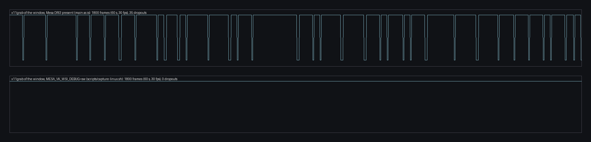

# The text dropout in captures: a capture artefact, not the app

> **Media:** the screenshots and clips named here are in the private repo [synaps-desk-evidence](https://github.com/HaseebKhalid1507/synaps-desk-evidence/tree/main/docs/img), at the same paths. See [EVIDENCE.md](../../EVIDENCE.md).

On bella, an x11grab recording of the offline demo (`--offline`, headless gamescope, lossless at
30 fps) loses the text of the diff block and of inline code (`Session`) for one frame (4 video
frames at 8 redraws a second) every couple of seconds, then gets it back
([before, frames 40 | 41](../../img/dropout/before-frames-40-41.png); first seen in
`docs/img/motion1/main-text-dropout-frames-11-12.png` on the motion branch). It happens on main
9667ba5.

**Root cause.** The app draws those frames whole. The recording reads the window back through
Xwayland (`XGetImage` on the window, as `x11grab -window_id` and `import -window` do). With Mesa's
Vulkan driver for Intel (ANV, Mesa 26.2.6) presenting over DRI3 with explicit sync to Xwayland
24.1.15, that read sometimes returns the frame before the GPU has finished it: without the
frame's **last draw call**. The read keeps returning that image until the next frame is
presented. In this window the last draw call is the transcript's last batch of glyphs: the 427
sprites of the diff block and the inline code (they sit on their own backgrounds, so GPUI batches
them after everything else). The compositor's own output never shows it.

Where it is not:

| suspect | ruled out by |
| --- | --- |
| the bounded text-view cache (M5), the hold-back (L11), rows laid out a frame late | GPUI's scene is the same, byte for byte, in the dropout frames (below); the diff block is not a text view at all |
| GPUI's line-layout cache, glyph atlas eviction | same scene: every glyph sprite, tile and colour identical; one subpixel atlas texture, never removed or re-made |
| a periodic timer in the demo | the demo draws nothing when idle (0 changed frames in 20 s); dropouts come with redraws, about one in 20, at any redraw rate (4/s, 8/s, a bare `cx.notify()` every 125 ms) |
| a cached view not repainting | same scene |

## Evidence

All on bella (Intel Arc ARL iGPU, Vulkan), offline demo, nord, text 16, 1920x1080, the pointer
moving between two rail rows 8 times a second so frames are drawn.

**1. The scene is identical.** A probe build (gpui-pre patched locally, not committed) hashed
every subpixel sprite (order, bounds, content mask, colour, atlas tile) at each `present()`.
Over 30 s, 243 presents, 8 dropouts on the recording: the band's 717 sprites hashed
`618c04e9ced64b0c` in every frame; the whole scene had two hashes, the two hover states, the
only quad that differs being the hovered row:

```
hash all=051c22963770c66f band=618c04e9ced64b0c band_sub=717 ... batches=Q125,S15,Q30,S1160,Q41,U1,M1,S292,Q28,M1,S298,Q5,S166,Q4,S427
hash all=6f56a7351bd06ab5 band=618c04e9ced64b0c band_sub=717 ... batches=Q125,S15,Q31,S1100,Q41,U1,M1,S352,Q28,M1,S298,Q5,S166,Q4,S427
```

No sprite batch was skipped by the renderer (a logged guard on a missing atlas texture never
fired).

**2. What vanishes is the last draw call.** The pixels that differ between a dropout frame and
the frame before (13,797 px, box 650,86..1263,428) against each batch's sprites: only batch 14,
the last (`S427`, box 650,75..1264,429), touches them, all 427 of its sprites; none of the
other 2,931 glyph sprites (batches 1, 3, 7, 10, 12) touches a changed pixel.

**3. The frame is read before the GPU finishes it.** Same probe build, 30 s each:

| | dropouts |
| --- | --- |
| as is (control) | 13 |
| `device.poll(Wait)` on the frame's submission before `present` | 0 |
| `MESA_VK_WSI_DEBUG=sw` (Mesa waits for the frame, then copies it to the window) | 0 |
| `MESA_VK_WSI_PRESENT_MODE=immediate` | 15 |
| `MESA_VK_WSI_PRESENT_MODE=mailbox` | 12 |

**4. The screen never shows it.** Headless sway 1.12 with Xwayland (the app on X11, as under
gamescope), Intel for both the compositor and the app (`WLR_RENDER_DRM_DEVICE=renderD128`,
`ZED_DEVICE_ID=0x7d67`), a redraw every 125 ms, 30 s: the x11grab recording of the window had 5
dropouts (bright pixels in the band 1,429 instead of 8,978, 36 of 900 frames); `grim` reading
the compositor's output (screencopy) of the same band 61 times a second had 1,825 of 1,825
samples at 8,978. On the NVIDIA GPU (the app's own pick under sway), 60 s: one single-frame blip in the recording, none in the compositor's output.
(gamescope's composited output could not be read: gamescope 3.17 segfaults in headless mode when
its PipeWire stream gets a consumer, and `gamescopectl screenshot` writes nothing headless.)

**5. Before and after, 60 s each** (`scripts/capture-linux.sh`, `scripts/frame-dips.py`, main
9667ba5's release binary, the same 8 redraws a second):

| capture | frames | changed frames | dropouts |
| --- | --- | --- | --- |
| `CAPTURE_WSI=dri3` (the driver's path, as recorded so far) | 1800 | 579 | 35 (4 or 8 frames each, 23-142 frames apart) |
| `CAPTURE_WSI=sw` (the script's default) | 1800 | 658 | 0 |



## What changes

- `scripts/capture-linux.sh`: the recording the motion and settings work did by hand (headless
  gamescope, `x11grab -window_id`, lossless 30 fps), with `MESA_VK_WSI_DEBUG=sw` for the app by
  default so the window's pixmap is always a whole frame. The pixels are the same; the present
  costs more CPU (Mesa copies the frame), so performance is never measured under it.
  `CAPTURE_WSI=dri3` keeps the driver's path, to show the artefact.
- `scripts/frame-dips.py`: per-frame changes and dropout runs in a recording; exits 1 when there
  is one, so a capture can be checked in a script.
- `ui_tests::a_redraw_with_nothing_changed_keeps_every_text_view`: 40 redraws of the demo window
  with nothing changed keep every markdown row's text view (same entity, none stale), so the
  app's half (the frame is the same from one redraw to the next) stays true. It passes on main
  too: there is no app bug for it to catch.

The app's code is unchanged (test-only accessors aside), so is its cost. Idle, the offline demo
in headless gamescope at 1920x1080, 5 s settled then 15 s untouched, two runs each:

| build | frames drawn | CPU ticks (10 ms) | RSS |
| --- | --- | --- | --- |
| main 9667ba5 | 0, 0 | 3, 3 | 184,644 / 185,448 KB |
| this branch | 0, 0 | 3, 3 | 185,008 / 185,176 KB |

## Reproduce

```
scripts/capture-linux.sh target/release/synaps-desktop /tmp/cap 30 --offline          # 0 dropouts
CAPTURE_WSI=dri3 scripts/capture-linux.sh target/release/synaps-desktop /tmp/cap 30 --offline
scripts/frame-dips.py /tmp/cap/clip.mkv                                                  # dropouts listed
```
